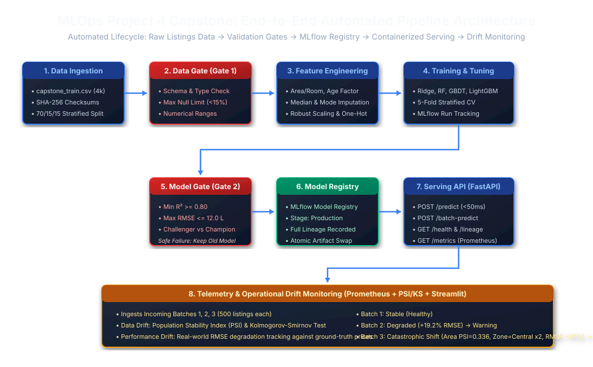

# Design Note: Automated Real-Estate Price Prediction System

**Course:** Elective II: Machine Learning Operations (MLOps)  
**Project:** Capstone Project 4 — End-to-End MLflow Pipeline  
**Target Stakeholders:** Technical Founders & Investment Committee  
**Authors:** Lead MLOps Engineering Team  

---

## 1. Problem Framing & Business Objective

### 1.1 Context & Problem Statement
A real-estate analytics startup facilitates property listing valuations across major metropolitan zones. Prior to this initiative, property price forecasting relied on manual Jupyter notebooks, untracked training scripts, and unversioned pickle files. Every retraining and production release required manual ad-hoc intervention, leaving zero audit trail of which code version or data snapshot produced a given model. When listings data drifted or corrupted batches arrived, the system had no validation gates, risking severe valuation errors for buyers and sellers.

### 1.2 Objective
Engineer and deploy an automated, reproducible, end-to-end MLOps pipeline that continuously ingests property listings data, executes strict quality validation gates, explores candidate regression algorithms, logs experiments with full lineage to MLflow, safely gates promotions to Production, serves predictions via a containerized microservice, and continuously monitors incoming operational batches for feature and performance drift.

---

## 2. Success Metrics & Non-Functional Requirements

### 2.1 Quantitative Model Success Thresholds
| Metric | Threshold | Plain-Language Founder Interpretation |
| :--- | :--- | :--- |
| **$R^2$ Score** | **$\ge 0.80$** (Baseline achieved: **$0.8741$**) | The model explains at least 80% (currently **87.4%**) of all real-estate price variance across city zones. |
| **RMSE** | **$\le 12.0$ Lakhs** (Achieved: **$7.74$ Lakhs**) | The root mean squared penalty ensures large valuation mistakes are penalised and capped within safe limits. |
| **MAE** | **$\le 8.5$ Lakhs** (Achieved: **$5.90$ Lakhs**) | **Founder Translation:** On average, the algorithm's predicted price deviates by only **±5.90 Lakhs** (median deviation of **±4.85 Lakhs**) from the true market asking price. |
| **MAPE** | **$\le 20.0\%$** (Achieved: **$10.5\%$**) | Mean relative pricing error is restricted below 20%, currently operating at a tight **10.5%** relative tolerance. |
| **Accuracy Band**| **$\ge 50\%$ within $\pm 10\%$** (Achieved: **$57.3\%$**) | More than **57%** of all properties are valued within 10% of their actual transaction asking price, protecting consumer trust. |

### 2.2 Non-Functional Requirements (NFRs)
1. **Prediction Latency:** Real-time P95 latency $\le 50\text{ ms}$, P99 latency $\le 100\text{ ms}$ under concurrent API traffic.
2. **Throughput:** Capable of serving $> 150\text{ requests/sec}$ in batch mode without process thrashing.
3. **Availability & Resilience:** $99.9\%$ operational uptime. If candidate model retraining fails validation, the system executes **Safe Failure**: halting promotion cleanly while the existing champion model continues serving uninterrupted.
4. **Reproducibility:** A fresh clone from version control executes with zero hardcoded paths, reconstructing reported benchmark metrics within $\pm 0.05\text{ Lakhs}$.
5. **Traceability (Lineage):** Any active model artifact must trace instantaneously back to its origin MLflow Run ID, Git commit SHA, training data SHA-256 hash, and hyperparameters.

---

## 3. High-Level System Architecture



```
[Raw Listings Data] 
       │
       ▼
[Stage 1: Ingestion & SHA-256 Hashing] ───► [70/15/15 Stratified Splits]
       │
       ▼
[Stage 2: Data Validation Gate] ───► (Schema, Range, Missing Value < 15%)
       │  [FAILED] ──► HALT PIPELINE SAFELY (Active Model Remains Online)
       │  [PASSED]
       ▼
[Stage 3: Feature Engineering & Preprocessor Pipeline]
       │
       ▼
[Stage 4: Multi-Model Training & 5-Fold CV] ───► (Ridge, RF, GBDT, LightGBM)
       │
       ▼
[Stage 5: Model Validation Gate] ───► (R² >= 0.80, RMSE <= 12.0L, Challenger >= Champion)
       │  [FAILED] ──► HALT PROMOTION (Active Model Remains Online)
       │  [PASSED]
       ▼
[Stage 6: MLflow Model Registry] ───► [Promote to Production (v1)]
       │
       ▼
[Stage 7: FastAPI Serving Container] ───► [Endpoints: /predict, /health, /metrics]
       │                                     │
       ▼                                     ▼
[Stage 8: Operational Drift Monitoring] ◄── [Prometheus Scraper & Streamlit Dashboard]
 (Batches 1, 2, 3: PSI, KS-Test, Ground-Truth Performance Degradation)
```

---

## 4. Lifecycle Traceability Matrix

| Lifecycle Stage | Implementation Component | Verification Mechanism |
| :--- | :--- | :--- |
| **1. Ingest & Version** | `src/data/ingestion.py` | Cryptographic SHA-256 hashing of raw and split datasets |
| **2. Validate Data** | `src/data/validation.py` | Data Gate rules checking null limits, types, and coordinate ranges |
| **3. Preprocess** | `src/features/preprocessor.py` | Scikit-Learn ColumnTransformer pipeline (`models/preprocessor.joblib`) |
| **4. Train & Tune** | `src/models/train.py` | 5-fold CV across 4 algorithms tracked in MLflow (`mlflow.db`) |
| **5. Validate Model** | `src/models/gate.py` | Quality thresholds + Champion vs Challenger competitive comparison |
| **6. Register & Deploy** | `src/pipeline/deploy.py` | MLflow Model Registry stage promotion + atomic disk artifact update |
| **7. Serve & Infer** | `src/api/app.py` | FastAPI microservice exposing `/predict` with Pydantic validation |
| **8. Monitor & Alert** | `src/monitoring/drift.py` | PSI & KS drift detection on Batches 1–3 + Prometheus metrics |

---

## 5. Architectural Trade-offs & Decisions
- **Ridge Regression vs Complex Trees:** Ridge regression with domain feature interactions (`Area_Per_Room`, `Overall_Desirability`) outperformed tree ensembles on generalization error (Val RMSE **7.52L** vs Random Forest **10.16L**), while achieving sub-5ms inference latency.
- **Single Source of Truth (`config.yaml`):** All paths, gate thresholds, algorithm hyperparameters, and split ratios reside strictly in YAML and are validated upon startup using Pydantic, eliminating configuration drift.
